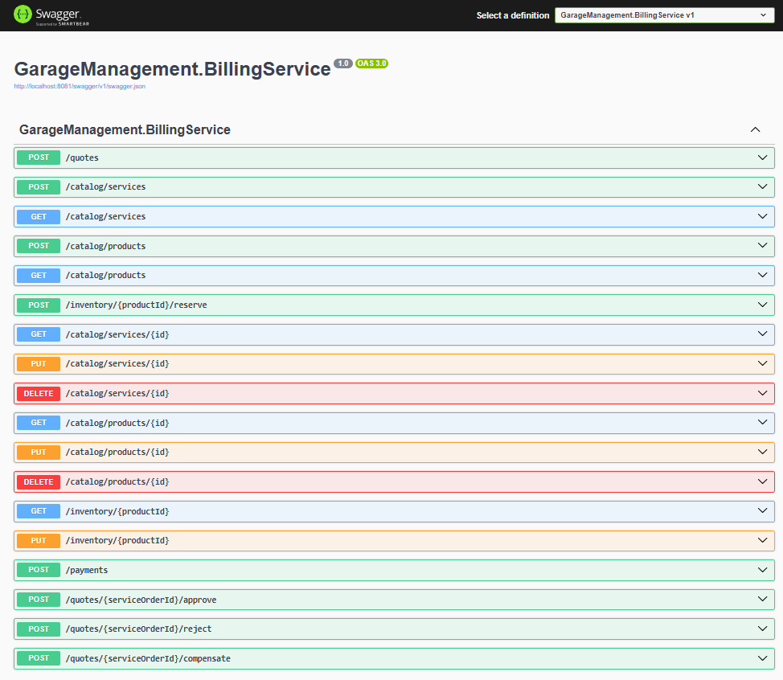

# Billing Service

O Billing Service é responsável por orçamento, catálogo, estoque e pagamento:

- criação, aprovação e rejeição de orçamentos;
- cadastro de serviços e produtos;
- reserva e liberação de estoque;
- processamento de pagamento simulado no ambiente local;
- publicação de eventos `QuoteApproved`, `PaymentApproved`,
  `PaymentRejected` e `QuoteRejected`.

Endpoints principais:

- `POST /quotes`
- `POST /quotes/{serviceOrderId}/approve`
- `POST /quotes/{serviceOrderId}/reject`
- `POST /quotes/{serviceOrderId}/compensate`
- `POST /payments`
- `GET /catalog/services`
- `GET /catalog/products`
- `GET /inventory/{productId}`
- `GET /health`

O `MercadoPagoGateway` acessa o serviço externo. Também foi configurado um simulador para apoiar os testes: `SimulatedPaymentGateway`.

## Documentação da Arquitetura do Service

Documentação:

- [Arquitetura dos microsserviços e da Saga](https://github.com/kmlyteixeira\garage-management-contracts\docs\saga-service-order-flow.md)

Fluxo resumido:

```text
OS Service -- POST /quotes --> Billing Service
                                  |
                         PostgreSQL + RabbitMQ
                                  |
             QuoteApproved / PaymentApproved / PaymentRejected
                                  v
                         Saga no OS Service
                                  |
                 falha -> POST /quotes/{id}/compensate
```

## Banco de Dados escolhido

[](#)

### Justificativa:

* [Open-source e amplamente utilizado](https://www.postgresql.org/about/)
* [Suporte a JSON (flexibilidade para evolução)](https://www.postgresql.org/docs/current/datatype-json.html)
* [Integração simples com Docker](https://hub.docker.com/_/postgres)


Tabelas principais: `quotes`, `quote_items`, `catalog_services`,
`catalog_products` e `inventory`.

## Caminhos para Dockerfiles e manifestos Kubernetes

- Dockerfile: [Dockerfile](./Dockerfile)
- Manifestos Kubernetes: [k8s/](./k8s/)
- Deployment e Service: [k8s/deployment.yaml](./k8s/deployment.yaml)
- Kustomize: [k8s/kustomization.yaml](./k8s/kustomization.yaml)
- Infraestrutura Terraform: [infra/](./infra/)
- Repositório de Infraestrutura: [garage-management-infra](https://github.com/kmlyteixeira/garage-management-infra)

## Evidência de cobertura de testes

O projeto possui testes automatizados com foco nos **domínios críticos**.

[](https://sonarcloud.io/summary/new_code?id=kmlyteixeira_garage-management-billing-service)

Testes automatizados:

- [tests/](./tests/)
- [GarageManagement.BillingService.Tests.csproj](./tests/GarageManagement.BillingService.Tests.csproj)

## Swagger

Em execução local:

```text
http://localhost:8081/swagger
```

Espaço reservado para inserir o print do Swagger:

